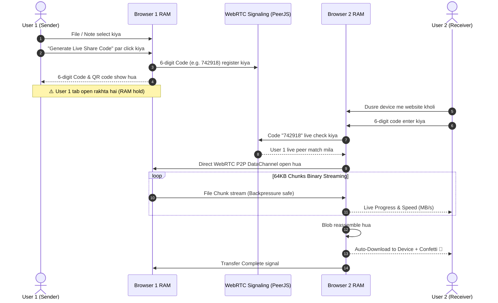

# ⚡ FlashBeam P2P - Zero Database Browser Memory Share

> **100% Zero-Database Direct Browser-to-Browser File & Note Sharing Web Application**  
> Isme koi bhi server database (MongoDB, SQL, Firebase, etc.) ya server file storage nahi hai! File direct User 1 ke Chrome browser ki RAM memory se User 2 ke device par WebRTC ke through download hoti hai.

---

## 🌟 Features (विशेषताएँ)

1. **🚫 Zero Database & Zero Server Storage**:
   - Files ya notes kisi bhi cloud server ya database me upload nahi hote.
   - Pura data sirf Sender (User 1) ke browser memory (RAM) me rehta hai.
   - Tab close hote hi sab kuch instant destroy/erase ho jata hai.

2. **📁 Any File & Large Size Streaming**:
   - Chrome browser jitna bada file input le sake (Videos, Photos, ZIP, PDFs, Documents, Software etc.).
   - WebRTC 64KB chunked binary streaming with backpressure control (`bufferedAmountLowThreshold`) taaki browser RAM overflow ya crash na ho.

3. **📝 Secret Note / Text Sharing**:
   - Credentials, passwords, code snippets, ya secret notes direct share karein.
   - 1-click clipboard copy aur `.txt` download feature ke saath.

4. **🔢 6-Digit Live Code & Instant QR Code**:
   - User 1 ko ek clean 6-digit PIN code (`742 918`) milta hai.
   - Mobile camera se scan karne ke liye live QR code bhi generate hota hai.
   - URL link copy karke direct share karne ki suvidha (`?code=742918`).

5. **⚡ Direct P2P Memory Download (Receiver)**:
   - Kisi dusre device (Mobile, Laptop, Tablet, PC) par website open karke 6-digit code enter karein.
   - Website live check karti hai ki User 1 online hai ya nahi.
   - Code verify hote hi direct User 1 ki memory se streaming shuru ho jati hai aur automatically file device me download ho jati hai!

6. **🎨 Futuristic Wow-Factor UI**:
   - Deep-space dark glassmorphism design with neon accents.
   - Radar beacon live animation.
   - Real-time progress bar (Transferred MB / Total MB, Live Speed in MB/s, Chunks).
   - Web Audio API synthesized sound effects (chimes, clicks, pings) - zero external audio asset dependency.
   - Celebration confetti on download completion.
   - Safety warning alert: "Keep this tab open while transfer is active".

---

## 🚀 How to Run (Kaise Run Karein)

### Option 1: Simple Local Server (Recommended for Mobile + PC sharing)
Is project me built-in zero-dependency Node.js server diya gaya hai jo aapke local Wi-Fi IP address ko print karta hai taaki aap PC aur Mobile dono par aaram se test kar sakein:

```bash
# Terminal me project folder ke andar run karein:
npm start
# ya
node server.js
```

Terminal me aapko do links dikhenge:
- 💻 **Local:** `http://localhost:3000`
- 📱 **Network:** `http://192.168.x.x:3000` *(Isko apne mobile ya dusre device ke browser me kholein!)*

### Option 2: Direct Static Open
Aap bina kisi server ke bhi direct `index.html` file ko kisi bhi modern browser (Chrome, Edge, Brave) me double click karke chala sakte hain!

---

## 🔍 Kaise Kaam Karta Hai? (Workflow)



---

## 🛡️ Privacy & Zero-DB Guarantee
- **No Database**: Codebase me MongoDB, PostgreSQL, SQLite, Firebase, Redis jaisa koi database nahi hai.
- **No Disk Upload**: Server par koi upload directory ya disk storage nahi hai.
- **Pure Memory**: Transfer hone ke baad ya tab band karte hi data hamesha ke liye gayab ho jata hai.
